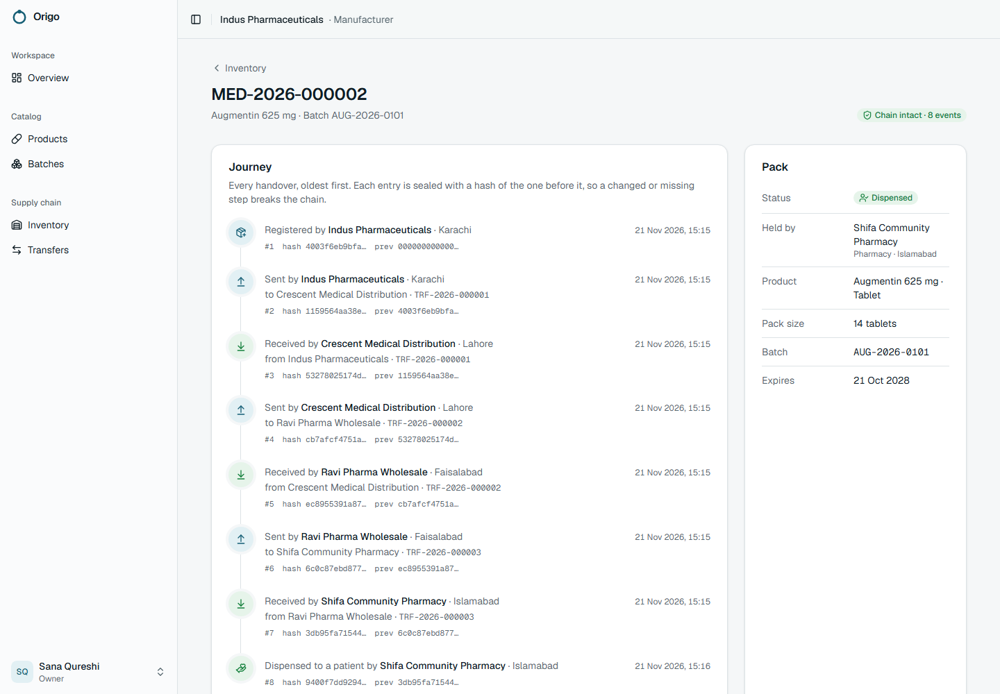
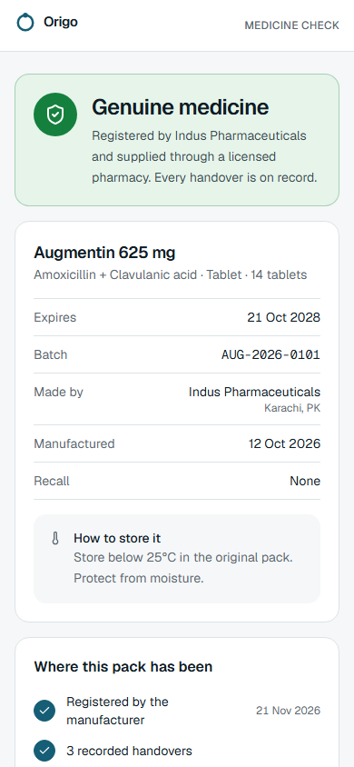
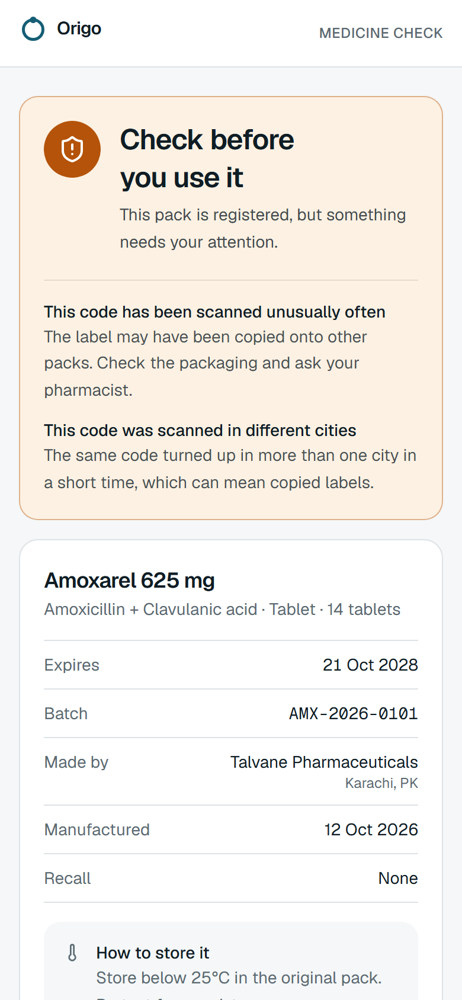
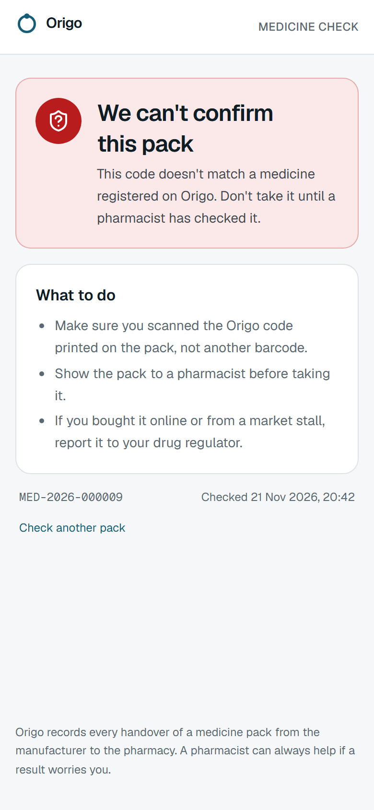
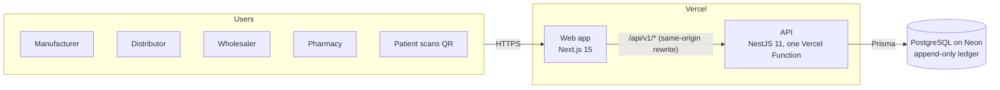
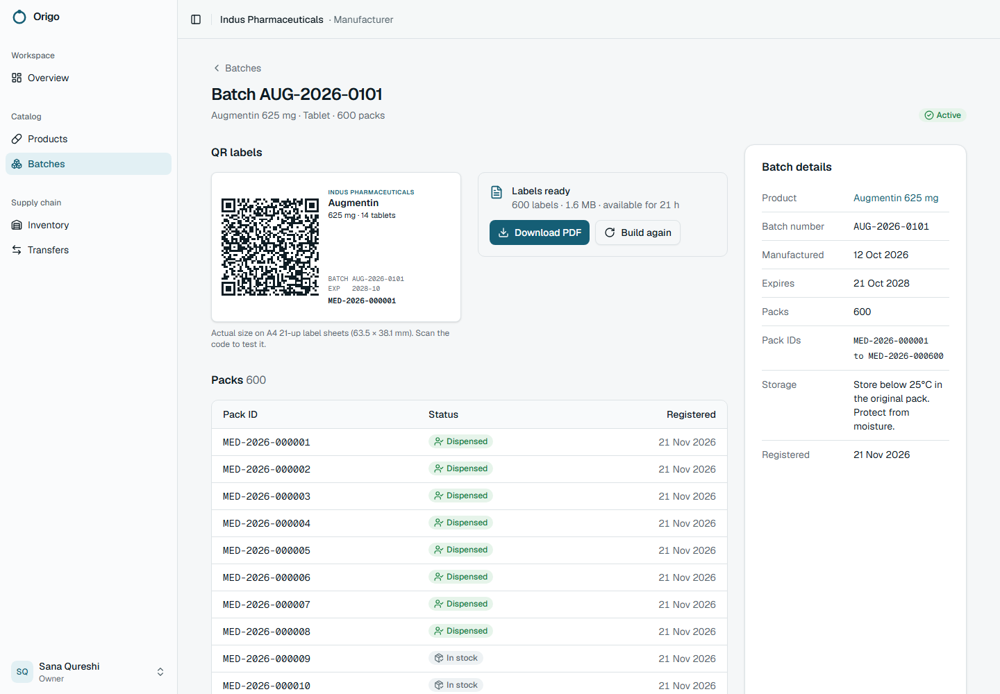
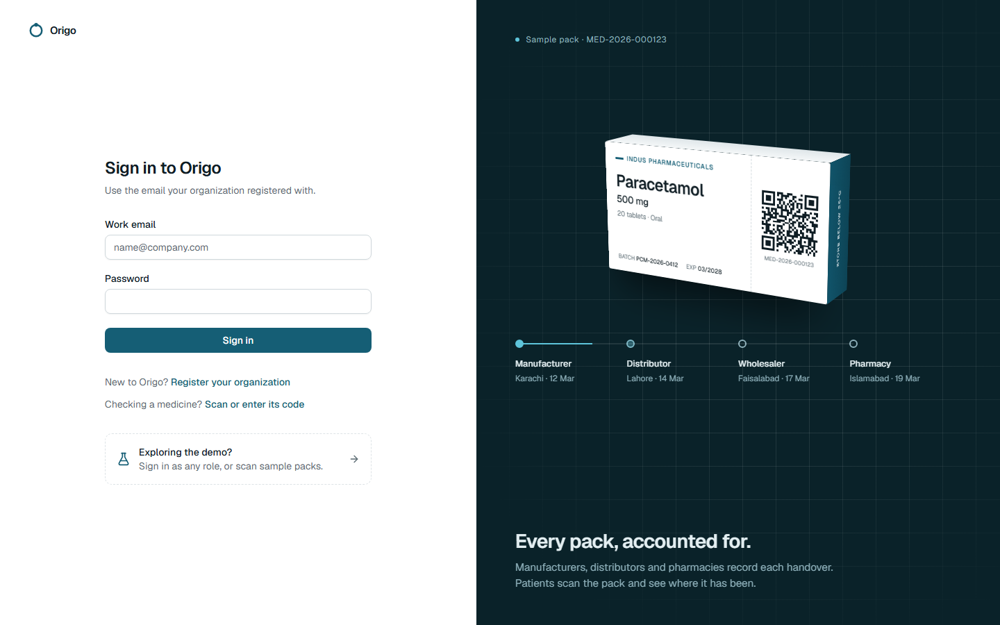
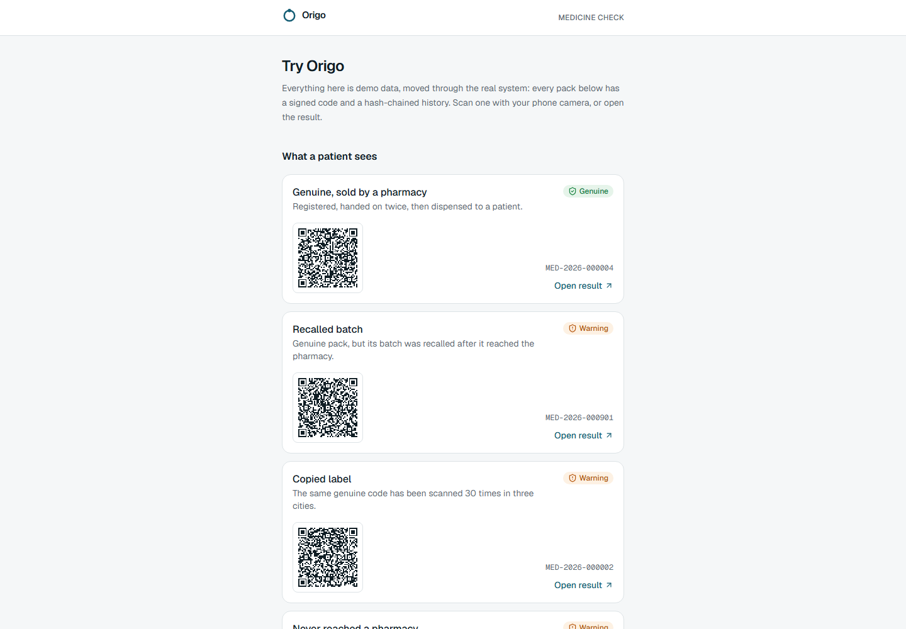
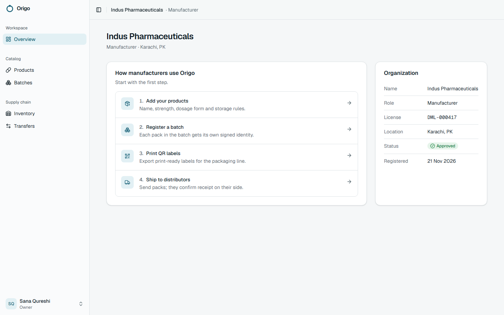

# Origo

**Medicine traceability and anti-counterfeit platform.** Every medicine pack gets a signed QR code. Manufacturers, distributors, wholesalers and pharmacies record each handover, and patients scan the pack to check that it is genuine.

[](https://origo-trace.vercel.app/demo)


**Try it:** [origo-trace.vercel.app/demo](https://origo-trace.vercel.app/demo). Sign in as any role with one click, or scan the sample packs with your phone.



## At a Glance

- Fake medicines are a real problem: a patient has no way to tell whether the box in their hand came from the real manufacturer.
- Origo gives each pack its own ID and a QR code signed with a private key only the platform holds, so a made-up or edited code is rejected right away.
- Each time a pack changes hands, both sides confirm it, and the event is added to a history where every entry holds the hash of the one before it. Quietly editing or deleting the past breaks the chain, and the app shows it.
- A patient scans the QR and gets a plain answer: genuine, check before use, or can't confirm. Copied labels are caught by how often and where the same code is scanned.
- It is a TypeScript monorepo (Next.js web app, NestJS API, shared Zod schemas, PostgreSQL) running live on Vercel and Neon.

**Contents:** [Getting Started](#getting-started) · [What This Project Does](#what-this-project-does) · [The Problem It Solves](#the-problem-it-solves) · [How It Works](#how-it-works-architecture) · [Tech Stack and Why](#tech-stack-and-why) · [Main Features](#main-features-and-how-they-work) · [Request / Response Flow](#request--response-flow) · [Key Decisions](#key-technical-decisions-and-trade-offs) · [Challenges](#challenges-and-how-they-were-solved) · [Future Improvements](#future-improvements) · [Deploying](#deploying)

## What This Project Does

Origo follows a medicine pack from the factory to the patient.

1. **A manufacturer** adds a product, registers a batch (for example 600 packs), and prints a sheet of QR labels for the packaging line. Each pack gets an ID like `MED-2026-000123`.
2. **The manufacturer sends packs to a distributor.** The packs are "in transit" until the distributor accepts them. The distributor then sends some on to a wholesaler or a pharmacy, who also accept.
3. **The pharmacy dispenses** a pack when it sells it to a patient.
4. **The patient scans the QR** with their phone camera. No app or account is needed. The page shows whether the pack is genuine, its expiry, recall status, storage rules and how many handovers it went through.

A platform admin approves every new company before it can do anything, so only licensed organizations take part.

|                  Patient: genuine pack                  |                           Patient: copied label                            |                     Patient: forged code                      |
| :-----------------------------------------------------: | :------------------------------------------------------------------------: | :-----------------------------------------------------------: |
|  |  |  |

## The Problem It Solves

- **Patients can't check medicine.** A good fake box looks identical to a real one. Printing a serial number doesn't help, because a fake can copy it.
- **Supply chains have blind spots.** When a batch is recalled or stock goes missing, it is hard to say who held which packs and when.
- **Records can be changed.** If history lives in a normal table, someone with access can edit a row and nobody notices.

Origo answers each one: signed codes that can't be invented, a two-step handover record for every pack, and a history that shows when it has been tampered with.

## How It Works (Architecture)



- **Web (`apps/web`):** Next.js App Router. Dashboards for each role, and a public, server-rendered verify page that loads fast on a cheap phone.
- **API (`apps/api`):** NestJS. Every module has the same shape: controller (input and output only) → service (business rules) → repository (the only place that talks to the database).
- **Shared (`packages/shared`):** Zod schemas, enums and response types used by both apps, so a form and the API validate input with the same rules.
- **Database:** PostgreSQL. Database constraints and triggers back up the rules the code enforces.
- **Background work:** label PDFs are built off the request. On a server this runs on a BullMQ queue with a separate worker process. On Vercel the API builds the PDF itself after replying. The same code runs in both setups (see [Key Technical Decisions](#key-technical-decisions-and-trade-offs)).

The browser only ever talks to the web domain. The web app forwards `/api/v1/*` to the API, so login cookies are first-party and `httpOnly`.

More detail: [docs/architecture.md](docs/architecture.md).

## Tech Stack and Why

| Technology                      | Used for                       | Why this one                                                                                                                                                       |
| ------------------------------- | ------------------------------ | ------------------------------------------------------------------------------------------------------------------------------------------------------------------ |
| **TypeScript** everywhere       | Web, API, shared package       | One language and one set of types from the form to the database                                                                                                    |
| **pnpm workspaces**             | Monorepo                       | The web app and the API import the same `@origo/shared` package directly                                                                                           |
| **Next.js 15** (App Router)     | Web app                        | Server rendering makes the patient verify page fast on slow phones; Server Components fetch data without extra client code                                         |
| **Tailwind CSS v4 + shadcn/ui** | UI                             | Accessible components the project owns and restyles, with its own design tokens and light and dark themes                                                          |
| **React Hook Form + Zod**       | Forms                          | Inline validation with the same schema the API uses                                                                                                                |
| **NestJS 11**                   | API                            | Modules, guards and dependency injection fit a domain with many roles and permission rules                                                                         |
| **PostgreSQL 16 on Neon**       | Database                       | Relational data with real constraints, row locks, triggers and transactions; Neon is managed Postgres with branches (`main` for production, `dev` for development) |
| **Prisma 6**                    | ORM and migrations             | Typed queries and versioned migrations                                                                                                                             |
| **Ed25519** (Node `crypto`)     | Signing QR codes               | Short signatures that fit in a QR; the public key can be published so anyone can check codes offline                                                               |
| **Own JWT auth + argon2id**     | Login                          | Organization approval and roles are central to the product, so auth is built in rather than bolted on                                                              |
| **BullMQ + Redis**              | Background jobs (server setup) | Retries, progress and a separate worker for building large PDFs                                                                                                    |
| **PDFKit + qrcode**             | Label PDFs                     | Vector QR codes laid out on standard A4 21-up label sheets                                                                                                         |
| **Vercel**                      | Hosting for web and API        | Free, no card needed, and the API runs as one serverless function in Singapore (`sin1`), next to the database                                                      |
| **Docker + Caddy**              | Alternative server setup       | A ready-made VM deployment (API, worker, Redis, automatic HTTPS) in `infra/`                                                                                       |
| **pino + Sentry**               | Logs and errors                | JSON logs with a request ID on each line; error tracking when a DSN is set                                                                                         |

## Main Features and How They Work

### 1. Company sign-up and admin approval

- **What the user sees:** a company registers with its type (manufacturer, distributor, wholesaler or pharmacy) and licence number, then waits on a review screen until an admin approves it.
- **What the code does:** three global guards run on every API route. The first checks the login, the second checks role and organization rules (`@Roles`, `@RequireApprovedOrg`, `@PlatformAdminOnly`), and every query is filtered by the caller's organization. Because the guards are global, a new route is protected by default. The user and their organization are reloaded on every request, so a suspension takes effect immediately.

### 2. Batches with signed pack IDs

- **What the user sees:** the manufacturer registers a batch with a pack count and immediately sees a live preview of the real label.
- **What the code does:** the batch and all its packs (up to 5,000) are created in one database transaction. Pack IDs come from one Postgres sequence, so they are unique across all companies. Each QR holds a URL like `/v/MED-2026-000123?k=k1&s=<signature>`, where the signature is an Ed25519 signature of the key ID and pack ID. The same pack always gets the same code, so no per-pack secret is stored.



### 3. QR label PDF export

- **What the user sees:** "Export QR labels" → a progress state → "Download PDF". The PDF is print-ready A4 with 21 labels per sheet and expires after 24 hours.
- **What the code does:** the API answers `202 Accepted` straight away and the PDF is built in the background, streaming pack IDs in pages of 500 so memory stays flat. The web app polls the export status. Two small interfaces decide how the build runs and where the file goes. A queue job with the file on disk is used on a server. An in-function build with the file in Postgres is used on Vercel. A cron job removes expired files.

### 4. Two-step transfers

- **What the user sees:** the sender picks a batch and a quantity and chooses a receiver. The receiver sees it in their incoming list and can accept or reject with a reason. The sender can cancel while it is still pending.
- **What the code does:** the API locks that many in-stock packs (`FOR UPDATE SKIP LOCKED`, so two people sending at once get different packs), marks them in transit and writes a ledger event for each one. Accept moves ownership; reject or cancel returns the packs. A partial unique index makes sure a pack is never in two open transfers. Who may send to whom is defined in one shared table: manufacturer → distributor; distributor → wholesaler or pharmacy; wholesaler → pharmacy. `POST /transfers` takes an `Idempotency-Key`, so a retried request doesn't create a second transfer.

### 5. Tamper-evident pack history

- **What the user sees:** a timeline of every event for a pack, with a "Chain intact" badge.
- **What the code does:** each ledger event stores `hash = SHA-256(previous hash | pack | sequence | type | organizations | transfer | time)`. A Postgres trigger rejects any `UPDATE`, `DELETE` or `TRUNCATE` on the table. Every read recomputes the whole chain and reports the first broken link. This was tested by editing and deleting rows directly in the database.

### 6. Pharmacy dispensing

- **What the user sees:** a "Dispense" button on the pack page.
- **What the code does:** it locks the pack, checks that the pharmacy owns it and that it is in stock, then marks it dispensed. It adds a `DISPENSED` ledger event and an audit log entry in one transaction.

### 7. Patient verification and copy detection

- **What the user sees:** a mobile page with a big, plain-language verdict (**Genuine**, **Check before you use it**, or **We can't confirm this pack**), followed by product, expiry, recall status, storage and a short journey summary.
- **What the code does:** see the [Request / Response Flow](#request--response-flow). A forged code is rejected by the signature check. A real code copied onto fake boxes is caught by the scan log: more than 25 scans, or scans from two cities within 24 hours, trigger a warning. The visitor's IP is never stored, only a keyed hash.

### 8. A demo world

- **What the user sees:** [`/demo`](https://origo-trace.vercel.app/demo) has sample packs for each verdict and one-click sign-in for every role.
- **What the code does:** the demo seed builds its data through the real services (real transfers, real ledger events, a recalled batch, a copied label), so the demo shows the system working, not hand-written rows.

|                    Sign-in                    |                         Demo page                         |                   Manufacturer overview                   |
| :-------------------------------------------: | :-------------------------------------------------------: | :-------------------------------------------------------: |
|  |  |  |

## Request / Response Flow

What happens when a patient scans a pack's QR code:

1. **The phone opens the URL in the QR**, for example `https://origo-trace.vercel.app/v/MED-2026-000004?k=k1&s=<signature>`.
2. **Next.js renders the page on the server:** `apps/web/src/app/(public)/v/[packId]/page.tsx` calls `verifyPack()` in `apps/web/src/features/verify/services/verify.server.ts`.
3. **The web server calls the API** at `GET /api/v1/verify/MED-2026-000004?k=k1&s=…`. It passes on the patient's IP and Vercel's city and country headers, plus a shared secret (`WEB_PROXY_SECRET`) that proves the location headers came from Origo's own web app.
4. **The API receives it** in its Vercel Function (`apps/api/api/index.js` → `src/serverless.ts`) and routes it to `VerificationController.verify` in `apps/api/src/modules/verification/verification.controller.ts`. The route is public, limited to 30 requests a minute per IP, and marked `no-store`. Location headers are only trusted if the secret matches.
5. **`VerificationService.verify`** (`verification.service.ts`) checks the ID format, then checks the Ed25519 signature with `QrSigningService.isAuthentic` (no database call needed). It then loads the pack. A forged signature for a real pack ID is logged and answered with "not recognized", revealing nothing about the pack.
6. **It loads the pack's ledger events**, and `LedgerService.verify` recomputes the hash chain. It also loads scan stats for the last 24 hours.
7. **`evaluate()` in `verification-rules.ts`** turns these facts into warnings: recalled, expired, history broken, not yet at a pharmacy, scanned too often, or scanned in many cities. It is one pure function ordered by severity, so it is easy to read and change. `verdictFor()` picks the verdict: `VERIFIED`, `WARNING` or `NOT_RECOGNIZED`.
8. **The scan is recorded** with the city, the country and an HMAC of the IP, never the IP itself.
9. **The API returns a minimal response**: verdict, reasons in plain words, product, manufacturer, batch, expiry and journey counts. It never names distributors or pharmacies and never returns internal IDs.
10. **The page renders** `VerdictPanel`, `PackFacts` and `JourneySummary`, and the patient sees the result.

## Key Technical Decisions and Trade-offs

| Decision                                                                                                             | Why                                                                                                                                                                                                                  | What was given up                                                                                                                                                                               |
| -------------------------------------------------------------------------------------------------------------------- | -------------------------------------------------------------------------------------------------------------------------------------------------------------------------------------------------------------------- | ----------------------------------------------------------------------------------------------------------------------------------------------------------------------------------------------- |
| **Hash-chained table in Postgres instead of a blockchain** ([ADR 0001](docs/adr/0001-hash-chain-over-blockchain.md)) | All participants are approved, known companies, so there's no need for public consensus. One transaction moves the pack and records the event, so ownership and history can't disagree. It is free and easy to read. | The platform operator is trusted: someone with full database control could rebuild a whole chain. Planned fixes are a separate migration role and a daily root hash published outside Origo.    |
| **Signed QR codes (Ed25519)** instead of random IDs                                                                  | A guessed or edited code fails instantly without a database lookup, and the public key can be shared for offline checks.                                                                                             | The private key must be kept forever, because losing it means printed labels can no longer be verified. A signature alone can't stop a photocopied label, so scan-pattern rules are needed too. |
| **Copy detection with simple rules**                                                                                 | Easy to explain to a patient and to tune.                                                                                                                                                                            | Rules can miss clever copying or flag unusual but honest use. A planned "scanned after dispensing" rule was dropped because patients normally scan after buying.                                |
| **One NestJS codebase, two entry points** (API and worker)                                                           | Shared modules, but the worker can scale on its own.                                                                                                                                                                 | It is still one deployable codebase, not separate services.                                                                                                                                     |
| **Label exports behind two small interfaces** (runner and storage)                                                   | The same feature runs on a VM (queue + disk) and on Vercel (in-function + Postgres), chosen by environment variables.                                                                                                | On Vercel there are no automatic retries (the user presses "Build again"), PDFs live in the database, and cleanup runs once a day because of Vercel's free plan.                                |
| **Live demo on Vercel instead of a VM**                                                                              | No server to maintain and no card needed.                                                                                                                                                                            | A 300-second function limit and cold starts on the first request after idle time.                                                                                                               |
| **Own authentication** instead of a hosted provider                                                                  | Roles, organization approval and suspensions are core to the product.                                                                                                                                                | More security-sensitive code to own: token rotation, reuse detection, rate limits.                                                                                                              |
| **No CI pipeline or automated test suite** (scope choice)                                                            | Kept the focus on a working, deployed product. Strict TypeScript, ESLint and a pre-commit hook (lint + typecheck) catch problems locally.                                                                            | Changes are verified by hand against the running app, not by tests on every push.                                                                                                               |

## Challenges and How They Were Solved

- **Running background PDF builds without a server.**
  - **Problem:** label export was built for a Redis queue, a worker process and a shared disk. The planned Oracle VM wasn't possible (card verification failed), and other hosts also needed a card.
  - **What was tried:** Render, Hugging Face Spaces, then Vercel.
  - **What worked:** splitting the feature into a _runner_ (queue or in-function) and a _storage_ (disk or Postgres). On Vercel the API replies `202`, keeps building with `waitUntil`, and saves the PDF in Postgres. Vercel buffers at most 4.5 MB per response, so downloads are streamed in 64 KB chunks. Settings that decide which modules load are read before Nest starts, so the serverless build never even opens a Redis connection.
- **Seeing the real visitor IP behind proxies.**
  - **Problem:** rate limits and audit logs would see Vercel's IP, so one busy user could lock out everyone.
  - **What worked:** a `TRUST_PROXY_HOPS` setting that tells the API how many proxies to trust in each setup (1 on Vercel, 2 on the VM behind Caddy). On the live site, the audit log recorded the real client IP and the login limit (5 a minute) applied to that IP.
- **Two people sending the same stock at once.**
  - **Problem:** two concurrent transfers could grab the same packs.
  - **What worked:** `FOR UPDATE SKIP LOCKED` so each request takes different packs, plus a partial unique index as the database's final guard.
- **Keeping each pack's history chain from forking.**
  - **Problem:** two writers appending at once could both build on the same previous event.
  - **What worked:** lock the pack row before reading the chain's last event, with `UNIQUE (pack_id, seq)` as a backstop.
- **Users logged out when two tabs refreshed at the same time.**
  - **Problem:** refresh tokens rotate, and reusing an old one revokes the session. Two tabs refreshing together looked like token theft.
  - **What worked:** a just-rotated token stays valid for 10 seconds.
- **A rule that flagged honest patients.**
  - **Problem:** the first design warned on any scan after dispensing, but that is exactly when a real patient scans.
  - **What worked:** dispensing became the last step in the journey, and copy detection moved to scan counts and locations.

> **Author note:** add, in your own words, the bug or problem that took you the longest and what you learned from it, then delete this line.

## Future Improvements

- **Several active signing keys.** Today only the current key ID is accepted. Rotating keys needs old keys kept for verification so printed labels keep working.
- **Stronger tamper protection:** a separate database role for migrations (so the app can't disable the ledger trigger), and a daily root hash published somewhere Origo can't edit.
- **Recall and expiry alerts:** a recall action in the UI (the demo's recalled batch is seeded), and notifications to everyone holding affected packs.
- **Automated tests and CI** for the transfer, ledger and verification rules.
- **Automatic demo reset**, so the public demo returns to a clean state every night.
- **Later phases** from [phases.md](phases.md): AI-based anomaly detection, IoT cold-chain monitoring, NFC tags, ERP/WMS integrations.

## Getting Started

Requirements: Node 22+, pnpm 10, Docker (for Redis), and PostgreSQL 16 (Docker or a Neon dev branch).

```bash
pnpm install

# 1. Redis (job queue). Add --profile postgres to also run a local Postgres instead of Neon.
docker compose -f infra/docker-compose.dev.yml up -d

# 2. Environment
cp apps/api/.env.example apps/api/.env        # set JWT_ACCESS_SECRET and the database URLs
pnpm --filter @origo/api qr:keygen            # paste QR_SIGNING_PRIVATE_KEY into apps/api/.env
cp apps/web/.env.example apps/web/.env.local

# 3. Schema and demo data
pnpm db:migrate
pnpm db:seed

# 4. Start web (http://localhost:3000), API (http://localhost:4000) and the worker
pnpm dev
```

### Demo data

`pnpm db:seed` creates the platform admin and one organization per role. `pnpm --filter @origo/api db:seed:demo` then builds a demo world through the real services: four products, transfers that were accepted, rejected, cancelled and left pending, dispensed packs, a recalled batch and a copied label. With `DEMO_MODE=true` (API) and `DEMO_PASSWORD` (web), `/demo` shows scannable sample packs and one-click sign-in for each role.

### Demo logins

Passwords come from `SEED_ADMIN_PASSWORD` and `SEED_DEMO_PASSWORD` in `apps/api/.env`. On the live site, use the one-click buttons on [`/demo`](https://origo-trace.vercel.app/demo).

| Role                               | Email                                                     |
| ---------------------------------- | --------------------------------------------------------- |
| Platform admin                     | value of `SEED_ADMIN_EMAIL` (default `admin@origo.local`) |
| Manufacturer                       | `manufacturer@demo.origo.dev`                             |
| Distributor                        | `distributor@demo.origo.dev`                              |
| Wholesaler                         | `wholesaler@demo.origo.dev`                               |
| Pharmacy                           | `pharmacy@demo.origo.dev`                                 |
| Pending pharmacy (awaiting review) | `pending@demo.origo.dev`                                  |

### Scripts

| Command                                 | What it does                                           |
| --------------------------------------- | ------------------------------------------------------ |
| `pnpm dev`                              | Web and API in watch mode                              |
| `pnpm build`                            | Production build of every package                      |
| `pnpm typecheck` / `pnpm lint`          | Type and lint checks (also run by the pre-commit hook) |
| `pnpm db:migrate`                       | Create/apply a migration in development                |
| `pnpm db:seed`                          | Load the admin and demo organizations                  |
| `pnpm --filter @origo/api db:seed:demo` | Build the demo world (products, transfers, scans)      |
| `pnpm --filter @origo/api qr:keygen`    | Generate a QR signing key pair                         |
| `pnpm db:studio`                        | Browse the database                                    |

## Deploying

See [docs/deployment.md](docs/deployment.md) for both production setups: the API as a Vercel Function (what the live demo runs, no server or card needed), or an Oracle Cloud VM with the API, worker, Redis and Caddy (automatic HTTPS). It also covers the Neon `main` branch, demo data and post-launch checks.

```bash
DEPLOY_HOST=ubuntu@<vm-ip> ./infra/deploy.sh            # build on the VM, migrate, restart, health check
DEPLOY_HOST=ubuntu@<vm-ip> ./infra/deploy.sh rollback   # back to the previous image
```

## Further Reading

- [Architecture](docs/architecture.md): data model, security, design system, environments
- [ADR 0001: a hash-chained ledger in Postgres instead of a blockchain](docs/adr/0001-hash-chain-over-blockchain.md)
- [Roadmap](phases.md)

---

Live at [origo-trace.vercel.app](https://origo-trace.vercel.app). If you find it useful, a ⭐ helps others find it.
